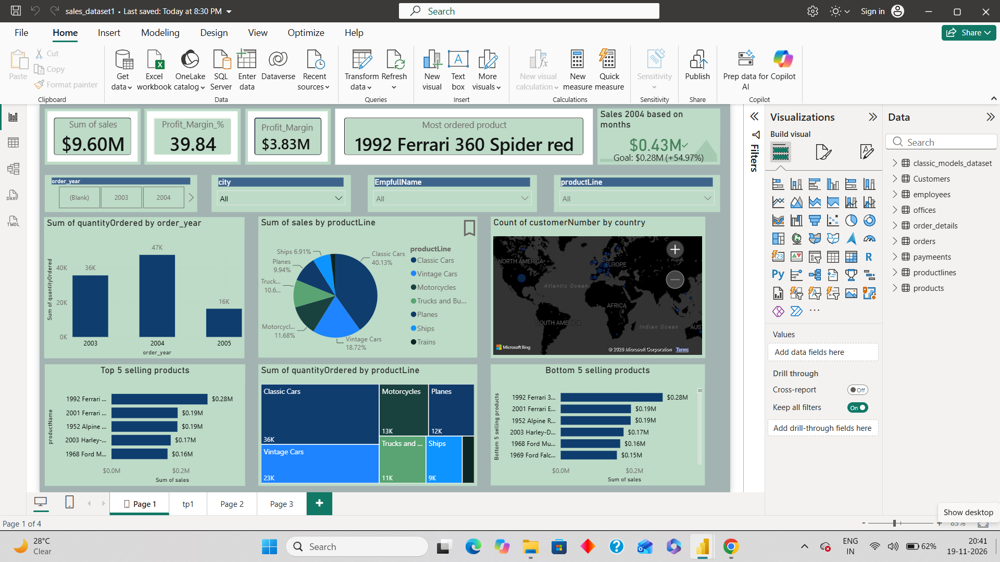

# Classic Models Sales Dashboard | Power BI

## Objective
Analyze sales performance, product demand and customer distribution for Classic Models, a scale-model car retailer, using an interactive Power BI dashboard.

## Dataset
The Classic Models dataset has 8 related tables (CSV files in this repo):
- customers
- employees
- offices
- orders
- order details
- payments
- products
- productlines

## Data Modeling
- Loaded the CSV files into Power BI and cleaned them with Power Query
- Built relationships between orders, order details, products, productlines, customers, employees and offices
- Created calculated columns: order_year, month_number, Month Name, FullName
- Created measures: Total Sales, Profit, Profit Margin %

## Dashboard Highlights
- *KPI cards:* Total Sales ($9.60M), Profit ($3.83M), Profit Margin (39.84%), Most Ordered Product
- *Quantity ordered by year*
- *Sales share by product line* (pie chart)
- *Quantity ordered by product line* (treemap)
- *Top 5 and Bottom 5 selling products*
- *Customers by country* (map)
- *Slicers:* order year, city, employee, product line

## Key Insights
- Classic Cars contribute the largest share of sales (about 40%)
- 1992 Ferrari 360 Spider red is the most ordered product
- 2004 had the highest quantity ordered

## Tools Used
Power BI Desktop, Power Query, DAX

## Files in this Repository
- sales_dataset1.pbix - Power BI report file
- CSV files - source data
- dashboard.1.png - dashboard screenshot

## How to Open
1. Download sales_dataset1.pbix
2. Open it in Power BI Desktop
3. If asked, update the data source path to the folder containing the CSV files

## Screenshot

